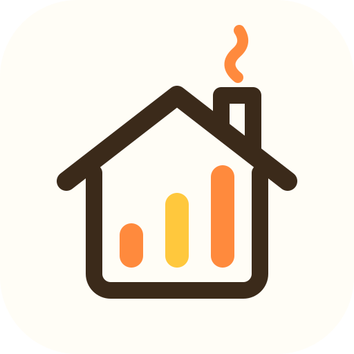

  

<h1 align="center">Hearthside</h1>

  A calm, private home dashboard. 
  One home, one clear picture.

---

> **Status:** early development.

## What it is

Hearthside is a private hub for your household, whether that is just you or a big family. It gives you one clear view of how your home is doing, month by month and year by year.

## Highlights

- **One clear picture.** Your household at a glance.
- **Monthly and yearly views.** See trends over time.
- **For any household.** Solo or shared, with room for privacy.
- **Works on any phone.** Install it like an app on iPhone or Android.

## Security

Please report security issues privately rather than opening a public issue.

## License

[Apache 2.0](LICENSE)
